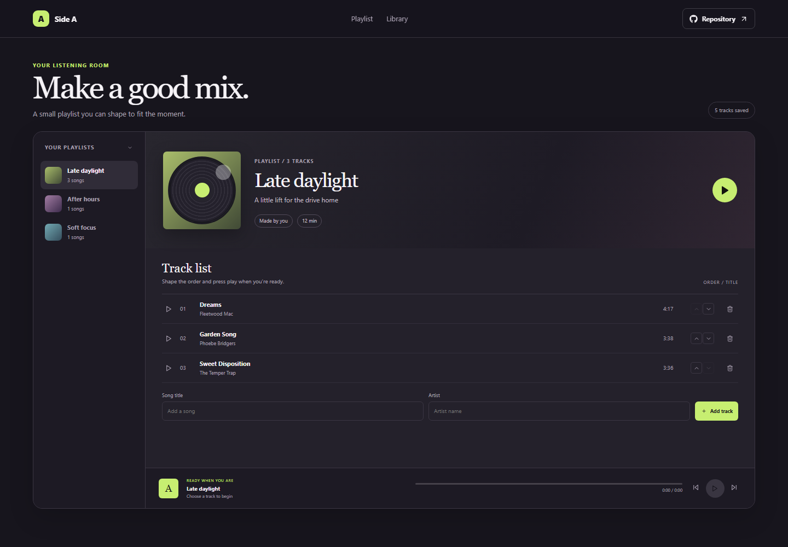

# Music Playlist Curator

Side A is a small playlist workspace for collecting tracks into listening sets and arranging them in a useful order.

**Live site:** [https://a2rp.github.io/music-playlist-curator/](https://a2rp.github.io/music-playlist-curator/)

## Interface

A playlist rail switches between Late daylight, After hours, and Soft focus. The selected mix shows its tracks, ordering controls, add form, and a fixed player strip with a timer and progress bar.

## Features and use

Choose a mix, add a song title and artist, then use the up and down arrows to reorder it. Play a row or use the transport controls to run the local listening timer. Remove a song through the confirmation dialog. The player does not stream audio.

## Data and limits

Track names, artists, playlist assignments, and order are stored in localStorage. Playback position is temporary and resets when the page is reloaded.

## Run locally

Use Node.js and npm, then run these commands from the project folder:

```sh
npm install
npm run dev
```

Run ESLint and create a production build with:

```sh
npm run lint
npm run build
```

## Deployment

The public app is published with GitHub Pages. Build and publish the current version with:

```sh
npm run deploy
```

Vite builds with the /music-playlist-curator/ project-page base path.

## Future improvements

These are ideas and are not implemented yet:

- Attach playable local audio files with user-provided licenses.
- Create and rename playlists, then export a playlist file.

## Links

- Portfolio: [https://www.ashishranjan.net](https://www.ashishranjan.net)
- GitHub: [https://github.com/a2rp](https://github.com/a2rp)
- CodePen: [https://codepen.io/ash1198](https://codepen.io/ash1198)
- LinkedIn: [https://www.linkedin.com/in/aashishranjan](https://www.linkedin.com/in/aashishranjan)
- Facebook: [https://www.facebook.com/theash.ashish/](https://www.facebook.com/theash.ashish/)
- YouTube: [https://www.youtube.com/@ashishranjan-ashz?sub_confirmation=1](https://www.youtube.com/@ashishranjan-ashz?sub_confirmation=1)
- Email: [mailto:ash.ranjan09@gmail.com](mailto:ash.ranjan09@gmail.com)

## Support

- Support: [https://a2rp-donation-page.netlify.app/](https://a2rp-donation-page.netlify.app/)
- Buy Me a Coffee: [https://buymeacoffee.com/ashishranjan](https://buymeacoffee.com/ashishranjan)
- Patreon: [https://www.patreon.com/ashishranjan](https://www.patreon.com/ashishranjan)